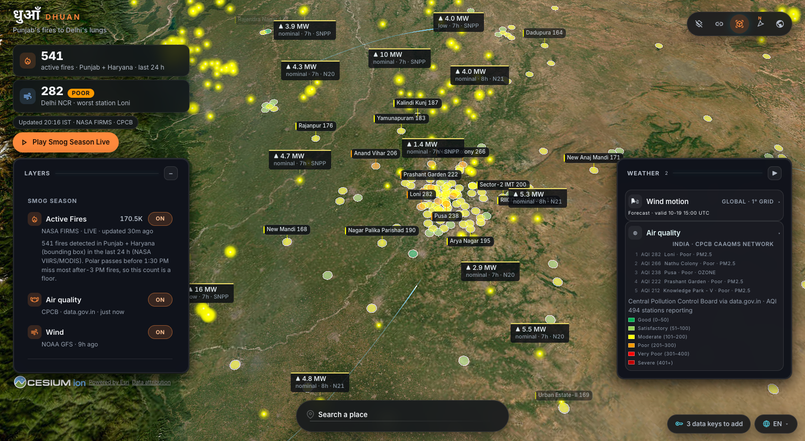
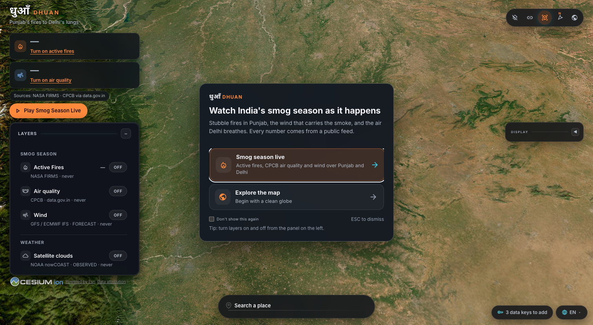

<div align="center">

# धुआँ

## Dhuan

### Punjab's fires to Delhi's lungs, live, in 3D.

Built on [God's Eye View](https://github.com/bilawalsidhu/gods-eye-view). The data is real.



_Screenshot from 19 Oct 2026, 20:16 IST. The 15-second clip lands on Day 3 of the launch plan. Numbers on screen are dated; the fire count is a floor, not a tally._

</div>

---

**Dhuan** (धुआँ, "smoke") is the India smog-season edition of God's Eye View, the open-source
3D globe. It puts three public feeds on one photoreal globe and plays the wind from the
fields to the city:

1. **NASA FIRMS** active-fire detections (VIIRS NOAA-20/21, Suomi-NPP and MODIS), with a live
   count for a Punjab + Haryana bounding box on the fire row and in the story strip.
2. **NOAA GFS** 10 m wind, animated. No key.
3. **CPCB** hourly air-quality stations across India via data.gov.in, in the six Indian
   NAQI bands and CPCB's own colours. A second provider for the upstream Air quality layer,
   not a replacement: ECCC's Canadian AQHI is one setting away.

It opens over Punjab at dusk, looking down the wind toward Delhi. A built-in Director scene,
**Smog Season Live**, plays the fires, the wind, then the Delhi NCR stations in about fifteen
seconds; the **Play** button under the wordmark runs it once. Flights, earthquakes and the
weather layers stay in the panel; the rest of God's Eye View (ships, satellites, transit,
the voice agent, the tactical HUD and the scope) is still in the code and one setting away.

### The interface

A calm briefing over a living globe, not a spy feed. The chrome is charcoal with one ember
accent; the data keeps its own colours. The globe always fills the screen: upstream's
circular scope mask and classification HUD are retired in this edition, not merely off, so a
share link or a scene cannot bring them back.

- **Story strip** (top left): the Punjab + Haryana fire count for the last 24 h, Delhi NCR's
  worst station with its NAQI band in words, the time the numbers were taken, and the Play
  button. A stat whose layer is off becomes the switch that turns it on.
- **Layers** (left, open by default): Smog season first (Active fires, Air quality, Wind),
  then Weather, then Also live (earthquakes, flights, recent imagery). Each row shows its
  source and age; the pill is the state in words.
- **Air quality card** (right): the five worst stations, the dominant pollutant, and the
  six-band legend with ranges.
- **Welcome**: "Smog season live" turns on the three story layers and keeps the camera over
  Punjab; "Explore the map" starts clean.
- **Search a place** (bottom): one search field, with quick pills for Delhi, Chandigarh,
  Ludhiana, Amritsar and Lucknow and their landmarks.
- **Keys**: the bottom-right chip counts the data keys still to add and opens the setup
  dialog, which lists only the five providers this edition's layers use (Google Maps,
  Cesium ion, NASA FIRMS, CPCB via data.gov.in, OpenSky). Language picker beside it.
- **Play** works without any key: the scene keeps whatever map is on screen instead of
  asking for Google's photoreal tiles.

Everything is keyboard-reachable, every control has a visible focus ring, no state is colour
only, and `prefers-reduced-motion` turns the remaining animation off. The theme lives in one
sheet, `src/ui/styles/dhuan.css`, scoped to `html[data-edition="dhuan"]`; upstream's
stylesheets are untouched.

<div align="center">



</div>

## Quick start

Node 24.14+ (or 26). No key needed to start; fires and stations need two free keys.

```sh
git clone https://github.com/sattyamjjain/dhuan.git && cd dhuan
npm ci && npm run doctor && npm run dev
```

Open http://localhost:4173. Then, in the app, open **Data keys** (bottom-right) and paste:

| Key             | Unlocks                                     | Get it                                                                                             |
| --------------- | ------------------------------------------- | -------------------------------------------------------------------------------------------------- |
| `FIRMS_MAP_KEY` | NASA FIRMS active fires (the Punjab count)  | https://firms.modaps.eosdis.nasa.gov/api/map_key/ (free, instant)                                  |
| `CPCB_API_KEY`  | CPCB stations across India (the Delhi dots) | https://www.data.gov.in/ → register → open any API resource → **Generate API Key** (free, instant) |

Both keys stay on the server (`/api/firms`, `/api/cpcb`); the browser never sees them. Do not
use data.gov.in's public sample key: it returns ten rows a call out of about 3,750, so the
layer would show nothing. The
same two lines work in `.env` (copy `.env.example`). Docker and Pinokio installs are
unchanged from upstream: `docker compose up` here, or install from Pinokio using this
repository's URL.

Then turn on **FIRMS Active Fires**, **Wind** and **Air quality** in the Layers panel, or open
**Scenes** and play **Smog Season Live**. If your browser already holds a God's Eye View scene
project from before this fork, import `scenes/smog-season-live.json` from the Scenes panel.

## What it shows, and what it does not

| Layer                | Source                                       | Refresh                         | Licence          | Caveat                                                                                                                                        |
| -------------------- | -------------------------------------------- | ------------------------------- | ---------------- | --------------------------------------------------------------------------------------------------------------------------------------------- |
| FIRMS Active Fires   | NASA FIRMS, VIIRS + MODIS NRT, trailing 24 h | 10 min poll, 30 min proxy cache | CC0 / US public  | Polar passes before 1:30 PM IST miss most after-3 PM burns, so every count is a floor. A detection is a hot pixel, not a verified field fire. |
| Wind                 | NOAA GFS 0.25°, latest 6-hourly cycle        | hourly                          | US public domain | A forecast, not an observation. It does not follow history.                                                                                   |
| Air quality (`cpcb`) | CPCB CAAQMS via data.gov.in, hourly          | 20 min poll, 20 min proxy cache | GODL (India)     | A station's AQI is the worst sub-index of at least three pollutants, one of them PM. Readings older than 3 h read STALE; older than 6 h drop. |
| Air quality (`eccc`) | Environment and Climate Change Canada, AQHI  | 20 min                          | ECCC open data   | Upstream's provider, Canada only. Set `VITE_AIR_QUALITY_PROVIDER=eccc` to use it.                                                             |

The Punjab + Haryana count is a **bounding box** (73.8–77.6 °E, 27.6–32.6 °N), not a state
boundary: it clips slivers of Rajasthan, Himachal, Uttar Pradesh and Delhi. The label says so.

Stubble burning is one of several sources of Delhi's PM2.5. CREA's November 2025 analysis
put it at roughly 7 percent on average across the season, with sharp peaks on burning days.
The city's own sources matter as much; this map does not say otherwise.

### The pledge

- No named-person search, no faces, no phones. Same line as upstream.
- **No cameras in India.** The public-CCTV and ALPR layers are not in this catalog.
- **No military or "vital installation" layers** (Official Secrets Act, 1923). Military flights,
  military awareness and military installations are not in this catalog.
- Every number shows its source and timestamp.
- Fires are what satellites saw, not what happened. Stubble is one of several sources.
- Not for health or emergency decisions.

Accessibility notes: the six NAQI colours are CPCB's bulletin palette and are never the only
cue. The legend pairs each swatch with its name and range, the readout list says the band in
words, and every station circle sits on a light ring so a dark band still reads over dark
terrain. On the map the Severe maroon is lightened to `#e0201c` for contrast; the legend keeps
`#c00000`. The loader bar and the panel transitions respect `prefers-reduced-motion`.

The five excluded layers stay registered in the code (the share-link token ledger and the
control surface expect them) but are hidden from the Layers panel, skipped by the voice
agent and refused by the layer manager, including from share links and stored state. The
policy lives in one file, `src/edition.js`; emptying it gives you upstream back.

## How the India pieces fit

- `server/providers/cpcb.js` — the `/api/cpcb` proxy. Walks the data.gov.in resource's pages,
  trims each row to the fields the client uses, caches 20 min in memory and on disk, serves
  stale when upstream fails, answers `503 {error:'no_key'}` without a key.
- `src/layers/airQuality/` — providers now own their band scale, stale line and key
  requirement (`AIR_QUALITY_PROVIDERS.cpcb`, `NAQI_BANDS`). `normalizeCpcbReadings` joins the
  one-row-per-pollutant feed into one reading per station and names the dominant pollutant.
  `createCpcbAirQualitySource` polls the proxy and keeps its last good snapshot through an
  empty hour. The layer takes everything else from the source it is given.
- `src/edition.js` — the Punjab home view, the fire region box, the excluded layer ids, the
  default provider, the caveat string, the panel grouping and glyphs, the welcome mission,
  the Delhi NCR box the story strip reads, and the chrome policy (no HUD, no scope by default).
- `src/dhuan/storyStrip.js` and `src/ui/styles/dhuan.css` — the story strip and the edition
  theme. The strip reads the layer stats the panel already shows; nothing in it fetches.
- `src/data/fireRegions.js`, `src/hudFireCounter.js` — the regional count, pure and tested.
- `src/scenes/recipes.js` and `scenes/smog-season-live.json` — the launch scene, as a built-in
  recipe and as a version-5 scene document.

Upstream's own documentation is preserved in [docs/UPSTREAM-README.md](docs/UPSTREAM-README.md);
[DATA_SOURCES.md](DATA_SOURCES.md) carries every licence and attribution, including the
Government Open Data License (India) for CPCB and NASA's FIRMS acknowledgement. Upstream
controls work as documented there, for example DISPLAY ▸ **Draw** outlines an area or route
on the globe and keeps it in the share link.

## Roadmap

This week ships the three layers, the scene, the clip and this README. Week 2: IMD
district-warning WMS, NASA Black Marble night lights for the 9 Nov "Diwali from space"
post, a Delhi buses GTFS-RT row, a daily auto-rendered clip, a hosted instance, and an
upstream pull request for the CPCB provider.

Never: live trains, any Indian CCTV, military or installation layers, people, faces, phones,
or a clip that says "Punjab did this" without the caveat.

## Credits

Built on **God's Eye View** by Bilawal Sidhu and Sameh Khamis, MIT. The upstream copyright
notice stays in [LICENSE](LICENSE); this edition adds its own line beneath it. Fire data:
NASA FIRMS (EOSDIS). Wind: NOAA GFS via NOAA Open Data on AWS. Air quality: Central Pollution
Control Board via data.gov.in, used under the Government Open Data License – India. The CPCB
scraper and IMD wrapper by Thejesh GN (Datameet) made the feasibility check short.

Tagline: _Punjab's fires to Delhi's lungs, live, in 3D._ Second line everywhere: _Built on
God's Eye View. The data is real._
